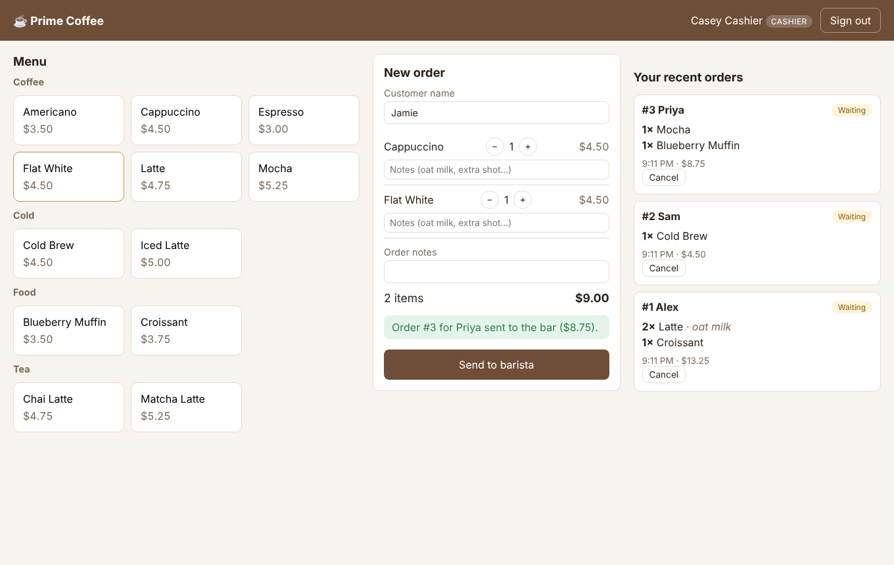
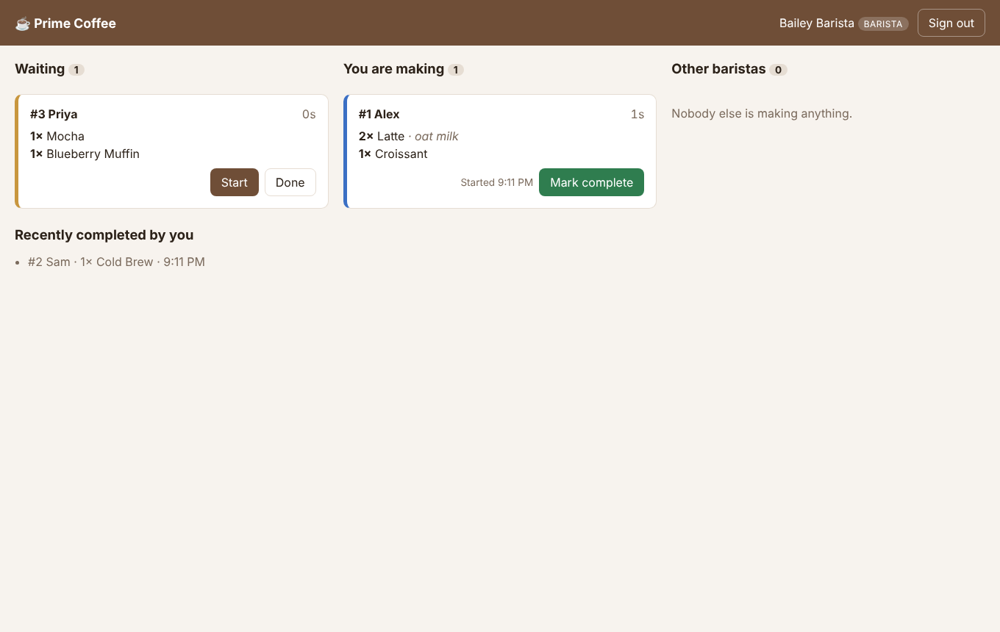
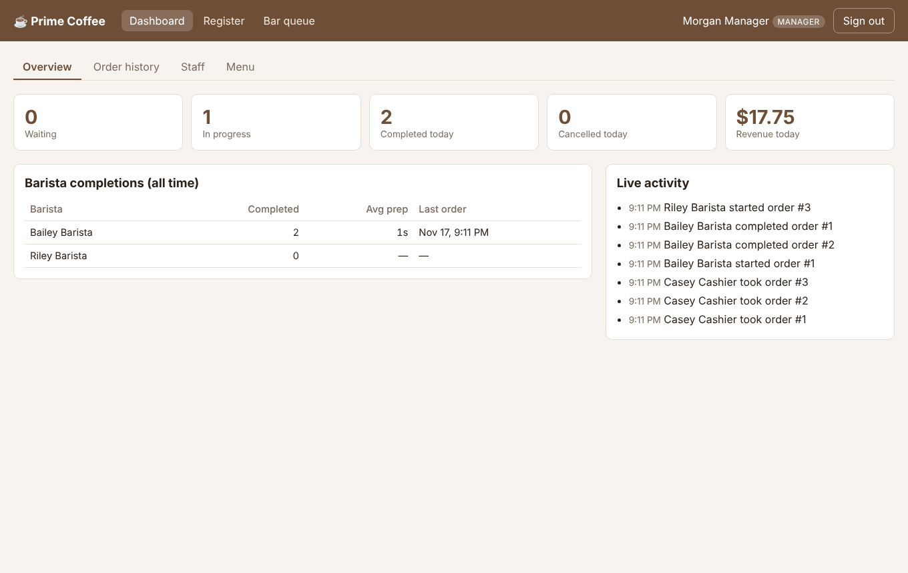
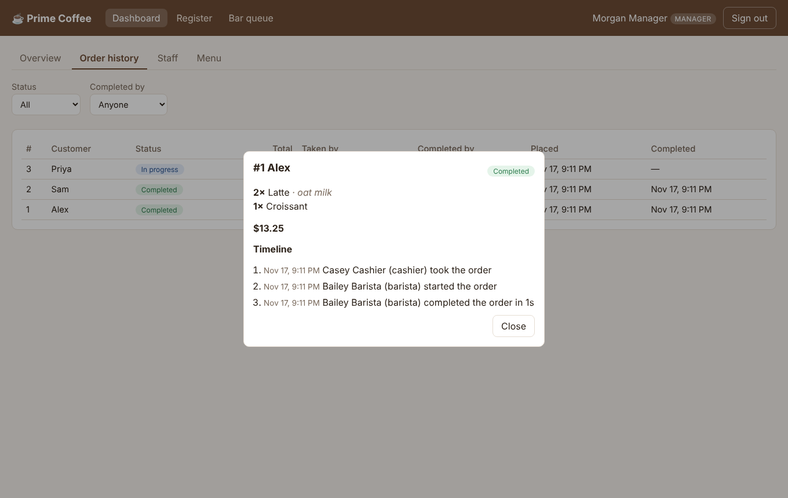

# Prime Coffee Co — ordering app

Cashiers take orders at the register and hand them to the bar. Baristas work a live queue, and the app records which barista completed every order. Managers see the whole shop: live activity, completion history per barista, staff and the menu.

| Register (cashier) | Bar queue (barista) |
| --- | --- |
|  |  |
| **Dashboard (manager)** | **Order history and timeline (manager)** |
|  |  |

## Stack

- **Frontend:** React 19 + TypeScript (Vite, React Router)
- **Backend:** Node.js + TypeScript (Express 5, zod validation, JWT auth, bcrypt passwords)
- **PostgreSQL:** users, menu, orders and order items. This is the source of truth for every order's current state, including who took it, who started it and who completed it.
- **MongoDB:** the `order_events` audit log. Every create, start, complete and cancel is appended as an event with the actor and a timestamp.

### Why the data is split this way

Orders, staff and the menu are relational and need transactions and constraints. For example, a completed order must have a `completed_by` barista, and two baristas cannot claim the same order. That belongs in Postgres.

The event log is append-only, write-heavy and never updated, and each event type carries different metadata (prep time, cancel reason, line items). Managers read it as a per-order timeline and a live activity feed. That fits a document store well, and it keeps audit volume off the transactional database. If MongoDB is unreachable, the API keeps taking orders and holds events in memory, so the register never goes down because of the audit log.

## Roles

| Role | Can |
| --- | --- |
| **Cashier** | Take orders, see their recent orders and who is making them, cancel orders nobody has started |
| **Barista** | See the queue, start an order, mark it complete (or complete straight from the queue), see what they completed |
| **Manager** | Everything a cashier can do, view the bar queue, dashboard and live activity, order history filtered by status or barista, each order's timeline, completions and average prep time per barista, add, deactivate and re-role staff, manage the menu, cancel in-progress orders |

Order lifecycle: `pending` → `in_progress` → `completed`, or `cancelled`. Claiming and completing are single conditional `UPDATE`s, so concurrent taps cannot double-claim an order, and a barista cannot complete an order another barista is making.

## Getting started

Requirements: Node 22+, Docker (for the databases).

```bash
npm install
cp .env.example server/.env   # change JWT_SECRET for anything beyond local dev
npm run db:up                 # Postgres on :5432, MongoDB on :27017
npm run seed                  # creates the schema, staff accounts and menu
npm run dev                   # API on :4000, web app on http://localhost:5173
```

### Seed accounts

All seed accounts use the password `primecoffee`.

| Email | Role |
| --- | --- |
| manager@primecoffee.test | Manager |
| cashier@primecoffee.test | Cashier |
| cashier2@primecoffee.test | Cashier |
| barista@primecoffee.test | Barista |
| barista2@primecoffee.test | Barista |

Try it with two browser windows: sign in as a cashier in one and as a barista in the other. The queue refreshes every few seconds.

## Tests

```bash
createdb prime_coffee_test   # once; or: docker compose exec postgres createdb -U prime prime_coffee_test
npm test
```

- `server/test` covers integration tests against a real Postgres: auth and role checks, the full cashier to barista hand-off, concurrent claims, completion attribution, cancel rules, the audit trail, menu admin and manager reports. The MongoDB event store test runs when `MONGO_TEST_URL` is set (CI sets it).
- `client/src` covers the cart logic, formatting and the login flow.

Override the test database with `TEST_DATABASE_URL`. CI (`.github/workflows/ci.yml`) runs typecheck, tests and build with Postgres and MongoDB service containers.

## API

All routes except login and health need `Authorization: Bearer <token>`.

| Method | Path | Who |
| --- | --- | --- |
| POST | `/api/auth/login` | anyone |
| GET | `/api/auth/me` | signed in |
| GET | `/api/menu` | signed in (`?all=true` for managers includes hidden items) |
| POST, PATCH | `/api/menu`, `/api/menu/:id` | manager |
| GET | `/api/orders?status=pending,in_progress&completedBy=&mine=true&limit=` | signed in |
| GET | `/api/orders/:id` | signed in |
| POST | `/api/orders` | cashier, manager |
| POST | `/api/orders/:id/start` | barista |
| POST | `/api/orders/:id/complete` | barista |
| POST | `/api/orders/:id/cancel` | cashier (pending only), manager |
| GET | `/api/orders/:id/events` | manager |
| GET, POST, PATCH | `/api/users`, `/api/users/:id` | manager |
| GET | `/api/reports/summary`, `/api/reports/baristas`, `/api/reports/activity` | manager |

## Project layout

```
server/            Express API (TypeScript)
  src/db/          schema.sql, migrate, seed
  src/events/      MongoDB order event store (+ in-memory fallback)
  src/routes/      auth, menu, orders, users, reports
  test/            integration tests (vitest + supertest)
client/            React app (TypeScript, Vite)
  src/pages/       Login, Cashier, Barista, Manager
docker-compose.yml Postgres 16 + MongoDB 7
```
